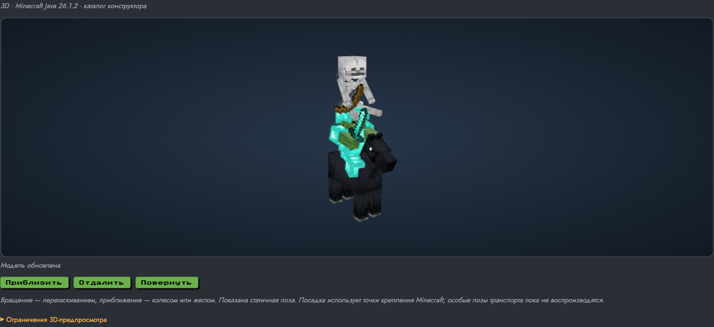
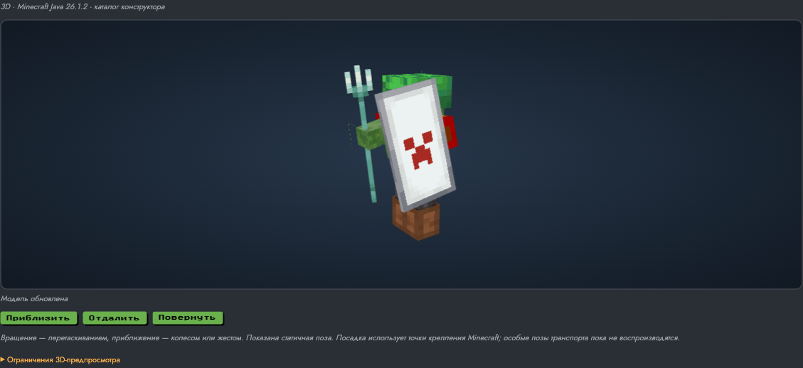

# Проверка полного каталога, 16 октября 2026

Финальный preview: [открыть `/summon`](https://mc-commands-lgfc0lesz-egorka-dinos-projects.vercel.app/summon). Deployment `dpl_7NYzRVeqVRBFGvsvh1ZDbfNiNnmY`, состояние READY, target null (preview). Production-домены не менялись; Git push не выполнялся.

## Экспорт и проверки

- Vanilla Minecraft Java 26.1.2; SHA1 client JAR совпадает с launcher JSON. SHA256: `b1b3158572666445eff01e82fad8c7de2e4953db6d354f311730d77a8359d0b0`.
- 94 ID сущностей: 93 с геометрией и один particle-only NoopRenderer (`area_effect_cloud`). 36 детских вариантов, 1046 статичных поз, 69 различных предметов и 5186 вариантов надетого снаряжения. 981 уникальный mesh, 235 непосредственно используемых текстур; дополнительные палитры/маски подготовлены автоматически.
- `verify-catalog.py`: полнота списков, позы, ссылки на геометрию/PNG, отсутствие missingno, конечные числа в вершинах и матрицах, quad topology и все hashes проходят проверку.
- Независимый экспорт в `/tmp/mc-opacity-proof` дал побайтно одинаковые 2065 файлов, включая полный manifest. После повторного запуска исходники экспортёра не менялись.
- 15 Node-тестов проходят. Проверяются соответствие настоящему каталогу редактора, доступность контекстов всех предметов, видимость слоёв, UV-ресурсы отделок/узоров, возрастные теги/цвета флагов/ID лодки, посадка с обеими точками, поза элитр, billboard-классификация, default states SHA256 каждого подготовленного файла и ненулевой alpha геометрии всех 981 meshes.
- `npm run build` проходит, включая обязательный prebuild с тестами; `npx tsc --noEmit` и `git diff --check` проходят.
- Сжатый транспорт каталога проверен распаковкой в отдельную временную директорию; файлы восстанавливаются с проверкой SHA256. Vercel собирает тот же каталог через Node prebuild; Java в deployment отсутствует.

## Браузер

Полный перебор выполнен локально и в Vercel preview: все 94 сущности доходят до статуса "Модель обновлена", все 80 разрешённых пар "предмет + слот" (69 уникальных ID) загружаются без ошибок ресурсов. Контрольный кадр дополнительно выявил неправильный packed color при submitModelPart: outline color 0 ошибочно использовался как ARGB, из-за чего исчезали трезубец и части флагов. Исправлено на настоящий color argument; PNG с видимым трезубцем перепроверен, а проверка alpha теперь обязательна при подготовке и сборке. Полный Vercel-перебор выполнен на предыдущем preview `mc-commands-b8gqeumzc-egorka-dinos-projects.vercel.app`; в финальном preview дополнительно перепроверены изменённые дефолты, элитры, billboard-сущности и сценарии ниже.

Для локального полного перебора сохранены 94 кадра: pixel-diff относительно particle-only облака подтверждает видимое изображение у всех остальных 93 сущностей. Это проверка отсутствия пустого кадра, а не сравнение с игровым эталоном.

Проверены смена сущности/экипировки из редактора, пять дополнительно подключённых детей (медведь, дельфин, аксолотль, лавомерка, счастливый гаст), окрас лошади, цепочка horse → zombie → skeleton, броня/трезубец/щит, окраска кожи, отделка silence/gold и узор щита. Сцена берётся из полей редактора, команда при этом обновляется независимо. Перетаскивание и колесо меняют изображение. Сфера опыта при повороте камеры сохраняет идентичный кадр, как billboard. Элитры используют сложенную baked rest pose.

До нажатия "Показать 3D" запросов к каталогу нет. При блокировке загрузки модели остаются команда и текстовый preview. При отключённом WebGL появляется объяснение fallback. Canvas также проверен на ширине 390 px: он помещается в viewport. В консоли остаётся существующий анонимный 401 от `/api/admin/minecraft/servers`; ошибок загрузки 3D-ресурсов и предупреждений Three.js в финальном preview нет.

## Граница проверки

Геометрию выдаёт сам CPU-код клиента Minecraft; ручной реконструкции моделей нет. Но кадры с запущенным Minecraft не сравнивались. Статичные render states задаются адаптерами, без полноценного игрового мира/AI. Анимации, все состояния/варианты, точные особые поправки транспорта, сетевые скины и ресурс-паки не объявляются проверенными. Полная матрица возможностей и ограничения: [catalog-coverage.md](catalog-coverage.md).
