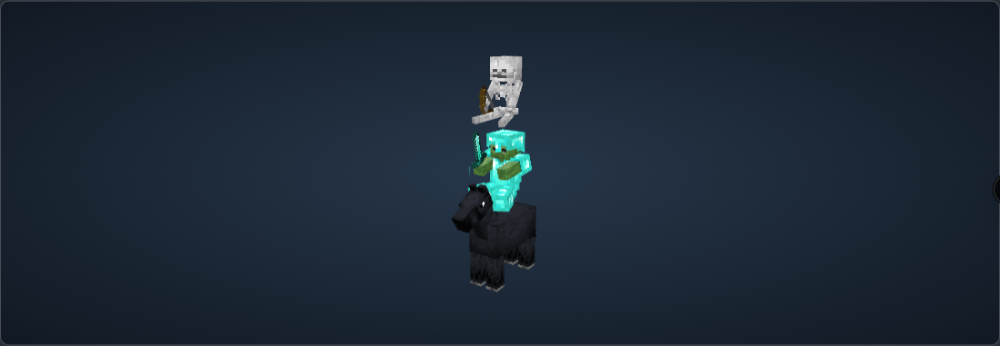

# 3D-предпросмотр: исследование и работающий срез

Проверено 15 октября 2026. Поддерживаемая версия ресурсов: **Minecraft Java 26.1.2**. Это отдельная версия визуализации: генератор команд по-прежнему ориентирован на 1.21.5+. Внешность старых версий не обещается, особенно детские модели, изменившиеся в 26.1.

## Вывод об Asset Renderer

Инструментарий пригоден для отдельного извлечения. На коммите [`2b69cd3464080dcb633038bd8d68a85201e75268`](https://github.com/minecraft-library/asset-renderer/tree/2b69cd3464080dcb633038bd8d68a85201e75268) реально выполнена задача `:tooling:entityModels`, без вызова image renderer и без запуска Minecraft. Получены `entity_models.json`, `entity_geometry.json`, `entity_poses.json` с `source_version: 26.1.2`. Повторный запуск сохранённого сценария тоже успешен.

Результат: 93 строки моделей, 155 геометрий, 120 таблиц поз и 74 animation clips. Это размеры таблиц библиотеки, **не процент покрытия всего Minecraft**. Сводка выбранных семейств сохранена в [asset-renderer-report.json](asset-renderer-report.json).

Важные места upstream:

- [`EntityModelsFlow`](https://github.com/minecraft-library/asset-renderer/blob/2b69cd3464080dcb633038bd8d68a85201e75268/tooling/src/main/java/lib/minecraft/renderer/tooling/EntityModelsFlow.java) объединяет bytecode discovery, геометрию, позы, слои и связи с текстурами.
- [`ToolingPipeline`](https://github.com/minecraft-library/asset-renderer/blob/2b69cd3464080dcb633038bd8d68a85201e75268/tooling/src/main/java/lib/minecraft/renderer/tooling/run/ToolingPipeline.java) использует `ClientOptions.defaults()`, а не аргумент CLI. Для опыта изменена только версия на 26.1.2; локальный JAR помещён в ожидаемый cache path. Сценарий фиксирует и проверяет эту правку.
- [`tooling/build.gradle.kts`](https://github.com/minecraft-library/asset-renderer/blob/2b69cd3464080dcb633038bd8d68a85201e75268/tooling/build.gradle.kts) позволяет запускать flow отдельно. Но tooling зависит от типов основного проекта: полностью изолированного маленького exporter JAR upstream не предоставляет. Сборка тянет Gradle/JitPack-зависимости.
- [`BoneKit`](https://github.com/minecraft-library/asset-renderer/blob/2b69cd3464080dcb633038bd8d68a85201e75268/src/main/java/lib/minecraft/renderer/bake/mesh/BoneKit.java) показывает, как трактовать данные. Pivot относителен родителю, cube origin локален детали, вращение ZYX, UV зависит от исходного размера, а не grow. Не следует полагаться на неоднозначные старые комментарии о "absolute pivots" в другом классе.

Таблицы можно читать в JS и строить Three.js meshes. В геометрии есть cube origin/size/UV, mirror, grow, parent, pivot, rotation/scale; в моделях — texture selection, axes, overlays и armor descriptors; в позах — вычисляемые позы и clips. Для GLB понадобятся собственная сборка полигонов, разрешение материалов/состояний и экспорт. GLB сам по себе не решает выбор внешности, conditional layers, позы и поведение экипировки. В этом срезе выбран JSON, GLB не реализован.

## Почему браузерный срез использует другой экспорт

После проверки библиотеки реализован более короткий путь: **тот же vanilla client JAR → игровой `LayerDefinitions.createRoots()` → `LayerDefinition.bakeRoot()` → JSON**. В 26.1.2 классы клиента доступны с именами. Достаточно JDK 25 и библиотек установленного клиента; Fabric, окно игры, OpenGL-контекст и Java renderer не нужны. Экспорт вызывает Bootstrap и model setup, но не запускает игровой клиент. Это аналог точки подключения Fabric-экспортёра к уже собранным моделям, вынесенный в отдельную подготовительную программу.

Преимущество: `ModelPart.Cube.polygons` уже содержит настоящие вершины, UV и нормали. Mirror и CubeDeformation уже применены игровым baker. Браузер не восстанавливает их по собственному описанию кубов. Иерархия, pivot, rotation, scale и исходная bind pose сохраняются отдельно. Отдельный scalar `grow`/флаг mirror в конечном mesh JSON не хранится: сохраняется их точный геометрический результат. Для редактирования деформаций нужно было бы дополнительно экспортировать исходные CubeDefinition или использовать таблицы upstream.

Затем вызывается настоящий `setupAnim` выбранного семейства для восьми сочетаний standing/riding и занятости двух рук. Сохраняются transforms деталей; `translateToHand` вычисляет крепления предметов. Постоянный transform `ItemInHandLayer` перенесён из проверенного bytecode 26.1.2; он выполняется при экспорте, а `display.thirdperson_*` предмета читается из JAR в браузере. У скелета сохраняется и его собственная поправка крепления рук. Это снимки состояния, не полноценная анимационная система.

Предметы типа generated/handheld строятся автоматически из alpha-контура настоящей PNG с толщиной 1/16 блока. Поддерживается один static `layer0`, parent chain и third-person display transform. Геометрия мобов не задаётся вручную.

## Воспроизведение

Нужен установленный vanilla-клиент 26.1.2 с его launcher JSON и libraries. JAR проверяется по SHA1 из launcher manifest; SHA256 исходного JAR записан в manifest ресурсов. Клиент и библиотеки не скачиваются экспортёром и не входят в репозиторий.

```sh
python3 tools/entity-export/export.py \
  --minecraft-dir "$HOME/Library/Application Support/minecraft" \
  --java /opt/homebrew/opt/openjdk@25/bin/java
python3 tools/entity-export/verify.py
npm run test:entity-preview
npm run build
```

Результат: `public/entity-preview/26.1.2/`. Параметр `--out /tmp/another-export` позволяет сравнить независимые экспорты. JSON канонизируется; повторный экспорт проверен сравнением manifest и всех его SHA256. Java нужна только на машине подготовки, Next/Vercel и посетитель её не используют.

Для повторения исследования upstream нужен также JDK 21, сеть для Gradle/JitPack и checkout указанного выше коммита:

```sh
python3 tools/entity-export/research-asset-renderer.py \
  --upstream /tmp/mc-asset-renderer \
  --minecraft-dir "$HOME/Library/Application Support/minecraft" \
  --java-home /opt/homebrew/opt/openjdk@21/libexec/openjdk.jdk/Contents/Home \
  --out /tmp/mc-export-tables
```

Сценарий не вызывает renderer. Он оставляет явную version-only правку в checkout upstream; commit проверяется до запуска. Если клонируется более новый HEAD, сценарий просит сначала checkout pin, а не молча меняет исходники другого коммита.

## Покрытие среза

| Область | Реализовано | Ограничения |
| --- | --- | --- |
| Геометрия | Зомби, скелет, лошадь, житель, разоритель; детские зомби, лошадь и житель | 5 семейств, не весь каталог конструктора; исходные baked meshes, без ручного моделирования |
| UV и текстуры | Vanilla PNG, nearest filtering, прозрачные грани, реальные UV и normals | Освещение Three.js отличается от игрового lightmap/shader; нет pixel-perfect parity |
| Броня | 4 слота у зомби/скелета, 6 материалов, leather dye + overlay; baby zombie armor с отдельной baby atlas | Нет trims, glint, elytra, тыкв, голов и черепашьего панциря |
| Предметы | Мечи, топоры, лук, палка; реальные item textures и display transforms, обе руки | Лук без натяжения; нет crossbow/trident/mace/shield, сложных item definitions, emissive layers |
| Варианты | 7 окрасов лошади переиспользуют один взрослый или детский mesh; поле влияет на `Variant` и сохраняется со snapshot | Нет markings, профессий/биомов/уровней жителя; показан plains villager |
| Пассажиры | Порядок из `mobOrder`, рекурсивная цепочка в команде, game-derived riding pose гуманоидов | Положение посадки приблизительное, статический family adapter; не извлечены runtime passenger attachment overrides и анимации транспорта |
| Позы/анимации | Настоящие статические `setupAnim` snapshots, включая riding/held state | Нет walking/attack/use-item clips; нет живой временной шкалы и переходов |
| Эффекты | Невидимость скрывает тело, снаряжение остаётся; attribute scale меняет размер | Нет огня, outline/glow, glint, частиц и визуализации potion effects; характеристики остаются в тексте |
| Resource packs | На этапе подготовки `--pack ZIP` (повторяемый) заменяет выбранные статические PNG в порядке приоритета | Только texture replacements с прежним aspect ratio; animated PNG отклоняются. Model/equipment definitions, CEM/OptiFine/EMF, CIT, шейдеры, новые namespaces не применяются. Посетитель не загружает пакеты |

На лошадь и разорителя не накладываются гуманоидная броня и предметы из обычных equipment slots: игра их так не рисует. У жителя возможен головной предмет, но соответствующий CustomHeadLayer в срезе ещё не подключён; интерфейс говорит об этом отдельно. Наличие предмета в SNBT или текстовой карточке не означает его визуализацию.

## Интеграция

`preview-scene.ts` получает `SummonSnapshot`, не строку команды. Визуальные изменения меняют scene key; изменение одного HP не пересоздаёт 3D. Three.js chunk подключается через `next/dynamic` только по кнопке. JSON и textures запрашиваются по выбранной сущности/слою; весь каталог не попадает в initial page load. Рендер выполняется по событиям OrbitControls/resize/обновления сцены, без постоянного animation loop. Устаревшие асинхронные сборки отбрасываются, GPU meshes/materials/textures освобождаются.

Неподдерживаемая сущность в цепочке переводит всю 3D-цепочку в явный fallback: неполная цепочка не выдаётся за готовую. Текстовый предпросмотр всегда остаётся. Сетевые ошибки, WebGL unavailable/context loss также показываются рядом с ним. Пример в панели **заменяет состояние редактора** лошадью с двумя пассажирами; это видно из надписи кнопки.

## Что дальше

Расширение каталога не требует описывать кубы каждого моба. Нужно расширять roster exporter и семейные адаптеры: model/render-state class, texture axes/overlays, видимые equipment layers, render scale, attachment rules, head/held-item logic. Текущие взрослые scale 1.1 у лошади и 0.9375 у жителя сверены с извлечёнными геометриями upstream; детские meshes уже имеют отдельные пропорции.

Для полного покрытия конструктора нужны item definitions/components evaluator (включая custom heads, block items, shield/banner patterns, trims), renderer layers, dye/tint, variants, entity-specific state extraction, точные mount anchors и анимации. Не все эти данные закодированы в `LayerDefinitions`: часть принадлежит renderer/extractRenderState, registries или игровому runtime. Для таких случаев оправдан Fabric capture после reload resources: тот же JSON-контракт получает final baked model, resolved textures, matrices и sampled poses. CEM/EMF возможен только при запуске соответствующих модов на подготовительной машине. Произвольную модовую логику в браузер автоматически перенести нельзя.

## Проверка

Оба экспорта реально запущены на одном клиенте 26.1.2. Проверены hashes, finite vertices/UV, unit normals, все 8 основных/baby meshes, 12 armor layers и hand matrices. Тесты scene adapter проверяют пассажиров, смену окраса без смены геометрии, соответствующий `Variant`, видимость экипировки и сохранение text fallback.

Локально проверены в браузере все пять семейств, цепочка с бронёй/оружием, неподдерживаемый creeper и текстовый fallback. Обнаружена и исправлена resize-петля canvas. Production build и TypeScript проходят. Дополнительные результаты браузера и preview deployment: [verification.md](verification.md).



Геометрия сравнивается с самой игрой через вызов её baker/setupAnim, но отдельное визуальное сравнение со скриншотом запущенного Minecraft не выполнено. Это не доказательство полной renderer parity. Модели и текстуры принадлежат Mojang; код экспортёра не меняет происхождение этих ресурсов.
